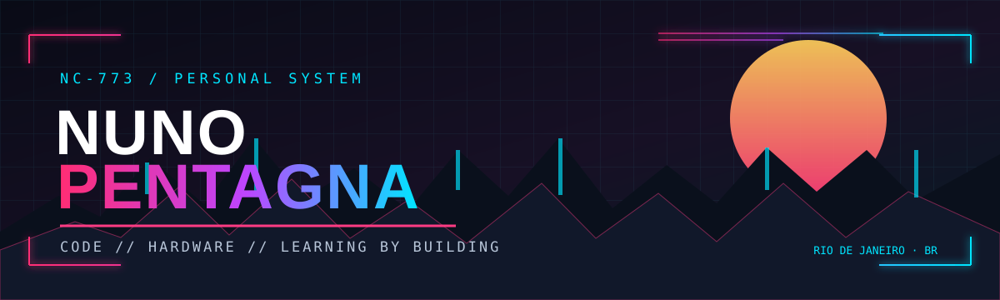

<div align="center">



[⌁ ABOUT](#-sobre)　//　[▣ PROJECTS](#-projetos)　//　[⌘ TOOLKIT](#-na-bancada)　//　[↗ CONTACT](#-contato)

</div>

---

### ▌ SOBRE // ABOUT ME

Fala! Sou estudante de **Ciência da Computação na Estácio** e estou construindo minha jornada na programação. Gosto de aprender na prática: escrever código, testar, errar, entender o motivo e tentar de novo.

Também curto hardware. Já montei computadores e fiz manutenção para familiares e amigos — então meu interesse por tecnologia não fica só na tela.

```text
┌─ CURRENT STATUS ──────────────────────────────────────────┐
│  LOCATION   Rio de Janeiro, BR                            │
│  STUDY      Computer Science                               │
│  FOCUS      Programming · Logic · Practical projects       │
│  SIDE QUEST Hardware · PC building · Troubleshooting       │
└───────────────────────────────────────────────────────────┘
```

### ▌ PROJETOS // SELECTED BUILDS

<table>
<tr>
<td width="50%" valign="top">

**01 / YouTube Video Analyzer**

Ferramenta em Python que trabalha com áudio de vídeos, transcrição via Whisper e geração de resumos com IA.

[↗ abrir repositório](https://github.com/ncorreia773-netizen/youtube-video-analyzer)

</td>
<td width="50%" valign="top">

**02 / Sistema de Controle de Notas**

Projeto em C para cadastro de alunos, cálculo de médias e classificação de resultados.

[↗ abrir repositório](https://github.com/ncorreia773-netizen/Trabalho-Sistema-de-Controle-de-Notas)

</td>
</tr>
<tr>
<td colspan="2">

**03 / Projeto Alura**

Uma calculadora em Python desenvolvida durante os estudos.

[↗ abrir repositório](https://github.com/ncorreia773-netizen/projeto-alura)

</td>
</tr>
</table>

### ▌ NA BANCADA // TOOLKIT

<div align="center">


</div>

No momento, estou fortalecendo minha base em lógica de programação, algoritmos e desenvolvimento. Não vou listar ferramenta que ainda não sei usar direito — conforme entrar na bancada, entra aqui.

### ▌ FORA DO TERMINAL

- Montagem e manutenção de computadores.
- Hardware e troubleshooting.
- Tecnologia, games e aprender fuçando.

### ▌ CONTATO // OPEN CHANNEL

<div align="center">

**E-mail:** [ncorreia773@gmail.com](mailto:ncorreia773@gmail.com)

<sub>✦ BUILT IN RIO · POWERED BY CURIOSITY · ALWAYS IN PROGRESS ✦</sub>

</div>
